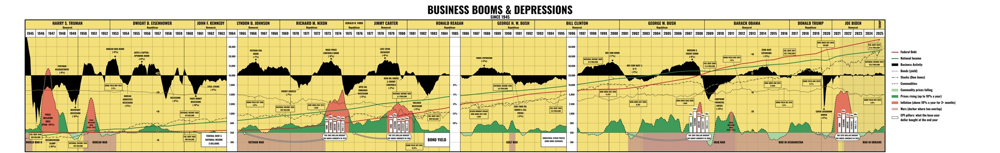

# Business Booms & Depressions, 1945–2025

A continuation of the 1944 wall chart *Business Booms & Depressions since 1775*, redrawn for the eighty years after it ended: business activity, commodity prices, federal debt, national income, stocks and bonds, with presidents, wars, recessions and booms. Built in November 2026 with Claude (Anthropic).



**[How it was made →](https://enricoronca.github.io/Business-Booms-Depressions-1945-2025/)** · [Hi-res PDF](chart_original_style.pdf) · [Data workbook](us_stats_final.xlsx)

## What is in this repository

| File | What it is |
|---|---|
| `chart_original_style.py` | The script that draws the whole chart from the workbook |
| `us_stats_final.xlsx` | The master Excel workbook with every series and formula |
| `chart_original_style.pdf` / `.png` | The finished chart, as PDF (vector, for printing) and PNG |
| `chart_preview.jpg` | The chart without the space underneath, for the web page |
| `01_…09_*.jpg` | Snapshots of the chart as it developed |
| `01_inflation_deflation_areas.md` | The first text block printed under the chart |
| `Oswald-Bold.ttf`, `OFL.txt` | The font and its licence (SIL Open Font License) |
| `index.html` | The "how it was made" page |

## Re-drawing the chart

```bash
pip install -r requirements.txt
python chart_original_style.py us_stats_final.xlsx
```

The script reads the workbook by column letter (the `COLS` setting near the top) and writes `chart_original_style.pdf` and `.png`. Every visual choice — frame ratio, scales, label positions, colours, the QR code — is a named setting at the top of the script.

## How the series are built

| Series on the chart | Source | How it is computed |
|---|---|---|
| Business volume (black area) | Industrial Production Index (FRED: INDPRO), monthly | 100 × (log of the index − its centred 121-month average). The average is shortened at both ends of the data, so values after late 2021 are provisional (grey band). |
| Commodity prices (dashed line, coloured areas) | Producer Price Index, all commodities (FRED: PPIACO) | % change over the previous 12 months, 3-month average. Red where it stays above 10% for at least 3 months. |
| Federal debt (red line) | Gross federal debt, annual | Plotted at mid-year |
| National income (green line) | National income, annual (BEA, via FRED) | Plotted at mid-year |
| Dow Jones (chain line) | Dow Jones Industrial Average, month-end close | |
| Bond yield (dotted line) | NBER long-term US government bond yield (to 1961); 10-year Treasury yield (FRED: DGS10, from 1962), month-end | Scale is inverted: high yields plot low |
| CPI pillars (white bars) | CPI: food, apparel (CPIAPPSL), shelter (CUSR0000SAH1), electricity, all items (BLS, via FRED) | 100 × average index in the base year ÷ average index in the end year: what a base-year dollar bought at the end year, in cents |

Presidential terms are rounded to whole years so that the dividers sit on the year lines; Franklin Roosevelt's last months in 1945 are therefore not shown.

## Credits and licences

- Original chart: *Business Booms & Depressions since 1775*, 1944, based on the chart of the National Association of Purchasing Agents. This repository continues its design for a personal print and is not affiliated with its publisher.
- Data: U.S. Bureau of Labor Statistics, Bureau of Economic Analysis, Federal Reserve Board, U.S. Treasury, National Bureau of Economic Research, all via the Federal Reserve Bank of St. Louis (FRED) where available. Dow Jones Industrial Average © S&P Dow Jones Indices; values are used for the chart only.
- Font: Oswald, © The Oswald Project Authors, SIL Open Font License 1.1.
